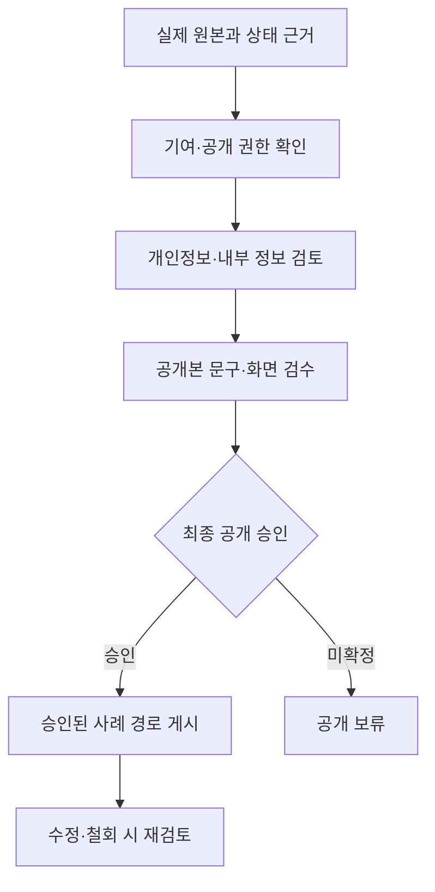

# 사례 상세 페이지와 공개 승인 설계

기준일: 2026-10-19 KST. 추가 실행 기준: `WEPLACE_PR8_Review_and_Next_Patch_2026-10-19(1).md`.

## 이번에 구현한 범위

`/review/case-layout.html`은 **허구임을 명시한 구조 검토 fixture**다. 실제 고객명·고객 자산·내부 사실·성과 수치·고객 인용을 담지 않는다. 문서 모형은 HTML/CSS로 만들었고 실제 납품·현장 사진처럼 표현하지 않았다. AI 이미지나 합성 이미지를 증거로 사용하지 않는다.

`noindex,nofollow`는 검색 색인을 줄이기 위한 설정이며 인증·비공개 기능이 아니다. 미리보기 URL이 열리면 누구나 볼 수 있으므로, 미승인 자료를 이 경로에 넣지 않는다. 실제 원본과 승인 기록은 접근이 통제되는 기존 업무 공간에서 검토한다.

홈페이지에는 실제 사례가 승인되기 전까지 검증되지 않은 완료 사례를 넣지 않는다. 별도 공개 사례 경로를 이번 변경에서 만들지 않았다.

## 이야기 구조와 필요한 증거

| 순서 | 화면의 역할 | 필요한 실제 근거 | 근거가 없을 때 |
|---|---|---|---|
| 현장 장면·고객 질문 | 누가 어떤 장면에서 무엇을 다시 확인했는지 보여준다 | 확인 날짜, 해당 화면, 반복 질문의 맥락, 필요한 인용 승인 | 관찰과 가설을 구분; 실제 고객 발언을 만들어 넣지 않음 |
| 함께 정한 범위 | 무엇을 만들기로 했고 어디까지 맡았는지 보여준다 | 범위·수량·수정·납품 조건의 합의, Weplace·고객·타 제작자의 기여 | 가상 예시로만 표시; 제공 범위 약속으로 공개하지 않음 |
| 실제 제작물 | 작업 원본과 고객이 볼 결과물을 연결한다 | 원본 파일·버전·검수 화면·제작일 | 코드 기반 구조 모형만 사용; 실제 납품으로 표현하지 않음 |
| 사용하는 장면 | 제작물이 실제 현장에서 쓰이는지 보여준다 | 최근 현장 기록, 버전 연결, 사용 확인일, 이미지·화면 공개 권한 | 빈 증거 자리 유지; 현장 사진을 합성해 채우지 않음 |
| 확인된 변화 | 실제로 확인한 반응·변화만 설명한다 | 전후 비교 기준·기간·분모·출처·인용 허용 범위·해석 한계 | 제작물·사용 장면까지로 마침; 수치나 고객 반응 생성 금지 |

각 섹션은 가운데 놓인 제목·짧은 설명을 사용하고, 근거·범위·상태는 좌측 정렬로 읽기 쉽게 분리했다. 모바일에서는 문서와 사용 장면이 한 열로 이어진다. 강제 슬라이드나 고정 높이로 사례 읽기를 막지 않는다.

## 작업 상태는 각각 다른 사실

다음 값은 **사례 편집 시 필요한 증거를 구분하는 기준**이다. 기존 FLOW의 `planned/working/done` 등 운영 상태를 대체하거나 신규 DB 상태로 저장하지 않는다. fixture에서는 네 상태 모두 `증거 미입력`이다.

| 편집상 상태 | 이 상태를 말하기 위한 근거 | 이 상태만으로 말할 수 없는 것 |
|---|---|---|
| 제안됨 (`proposal`) | 제안 문서·버전·제안일·대상 범위 | 제작 완료·납품·사용·성과 |
| 제작됨 (`created`) | 원본 산출물·버전·제작일·검수 기록 | 고객 전달·수령·현재 사용 |
| 납품됨 (`delivered`) | 전달일·전달 대상·납품 범위·수령 확인 | 현재 사용 여부·현장 성과 |
| 현재 사용 중 (`in-use`) | 최근 사용 장면·확인일·해당 원본과의 연결 | 매출·예약 증가 또는 원인 귀속 |

‘완료’ 한 단어로 네 상태를 묶지 않는다. 과거 사용 사진으로 현재 사용을 단정하지 않는다. 최종 공개 문구는 증거가 있는 상태만 표현한다.

## 실제 사례별 사실·승인 대장

실제 자료는 다음 필드로 접근 통제된 원본 대장에 기록한다. 이 공개 저장소의 fixture에는 고객 데이터나 원본 식별 정보를 넣지 않는다.

| 필드 | 기록 기준 |
|---|---|
| 대상 작업·날짜·의뢰 배경 | 관찰 사실, 고객 요청, 작업자의 해석을 나눔 |
| 작업 단계 | 제안·제작·납품·현재 사용별 근거 링크와 확인일 |
| 원본·버전 | 실제 파일·화면·현장 기록; 공개용 파생본과 구분 |
| 기여 범위 | Weplace·고객·타 제작자가 실제 맡은 범위 |
| 공개 권한 | 브랜드·사진·화면·인용별 허용 범위, 확인자·확인일 |
| 비식별 점검 | 사람·연락처·명단·내부 메모·계약 조건 및 재식별 가능성 |
| 반응·수치 | 실제 원문·인용 승인; 기간·기준·분모·출처·한계 |
| 게시·철회 | 최종 승인 책임자·확인일·공개 버전·철회 요청 경로 |

검토용 승인 체크는 실제 동의의 대체물이 아니다. 실명을 제거해도 재식별 가능성과 사진·브랜드·내용 사용 권한은 별도로 확인한다.

## 공개 게이트와 경로

예정 경로는 `/cases/{approved-slug}/`다. 실제 고객명·슬러그·파일·이미지는 위 게이트와 사용자 최종 게시 승인이 확인된 뒤 정한다. 이 문서의 경로 표기는 배포 허가나 URL 생성 완료를 뜻하지 않는다.

출시할 때는 공개 사례와 검토 fixture의 설정을 분리한다. 실제 사례의 title·description·canonical·검색 허용 여부·sitemap·OG 이미지와 본문 증거를 검수한다. 검토 페이지의 noindex를 운영 사례에 실수로 복사하지 않는다. 반대로 미승인 fixture를 실제 사례로 색인시키지 않는다.

FLOW의 기존 `draft → submitted → published`와 `archived` 공개 철회 정책을 보존한다. 고객 작업이 공유됐다는 사실을 공개 사례 동의로 보지 않는다. 공개 저널과 상세 사례에 같은 근거·버전·공개 범위가 적용되는지는 별도 승인 작업으로 연결한다. 이번 변경은 FLOW·DB·권한·공개 API를 쓰지 않는다.

## 화면 검토 도구

`/review/audience.html`에 개인정보 검토 페이지와 사례 구조 예시 버튼을 추가했다. 기존 360/390/430/768/1024/1440px 폭과 홈·업종·자가진단·미팅·내 매장·공개 기록 경로를 유지한다.

홈 장면 바로가기는 `#top`, `#what-we-make`, `#experience`, `#how`, `#contact`, `#site-footer`를 사용한다. 프레임 높이는 기본 `calc(100vh - 170px)`, 최소 600px이며 실제 검토 도구 상단 높이를 계산해 화면 안에 맞춘다. 페이지 본문이나 모바일 하단 CTA를 숨기는 스타일은 추가하지 않았다.

이는 검토 편의 기능이다. 폭 변경이나 구조상 반응형 CSS가 실제 브라우저·해당 기기의 시각 검수를 대신하지 않는다. 실제 렌더링·스크린샷 검수 결과는 별도 QA 기록에서 확인한다.

## 승인 대기

- 실제 제작·납품·현재 사용의 증거와 기여 범위.
- 브랜드·사진·화면·고객 인용·개인정보의 공개 범위.
- 실명 사례의 상세 경로·공개본과 최종 게시 승인.
- 검증된 성과 수치가 있다면 비교 기준·해석 한계 검토.
- 운영 병합·배포. 이번 fixture와 화면 검토 도구는 원격 게시를 자체 수행하지 않는다.
