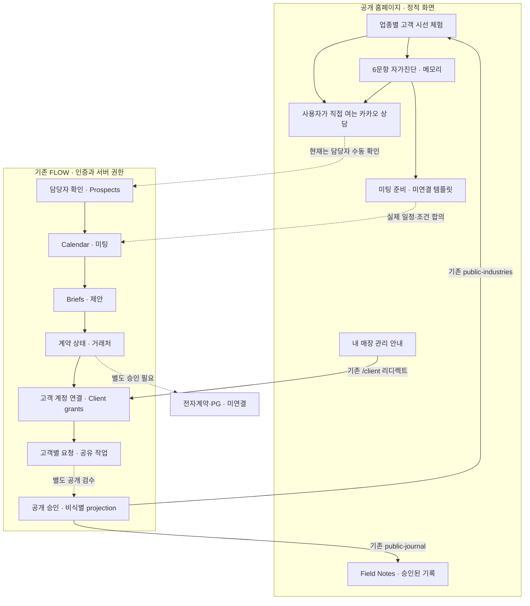

# 홈페이지와 FLOW 통합 구조

기준일: 2026-10-19 KST. 검토용 브랜치이며 운영 배포·데이터 변경·자동 개인정보 저장·결제 활성화는 수행하지 않는다.

실선은 화면 연결 또는 확인된 기존 객체 관계를 나타낸다. 점선은 담당자의 확인·별도 승인·미구현 전환이다. 이 도식은 홈페이지 클릭을 자동 CRM 접수·계약·결제로 처리한다는 뜻이 아니다.

## 원본과 배포

| 대상 | 확인된 기준 | 상태 |
|---|---|---|
| 홈페이지 | `HotCharliepepper/Weplace`, main `ec714758367b5bc448d61cc8c73b6fd2a3de9007` | CONFIRMED |
| 홈페이지 운영 | Netlify `weplace`, deploy `6acf8753289dcea4ef81258f`, ready, main SHA 일치 | CONFIRMED |
| 홈페이지 새 변경 | `feature/weplace-customer-discovery-20261019`, main에서 독립 생성 | 검토 브랜치 |
| 기존 PR #4 | merged | CONFIRMED |
| 기존 PR #5 | Draft/open, 영어·시장 근거·가격안; 이번 변경의 기반 아님 | CONFIRMED / 가격 미승인 |
| FLOW 실제 서버 소스 | `HotCharliepepper/WEPLACEFLOWVisualBaselineV0.2`, `feature/industry-folders-20261014`, `29dace237c8a2ce2323a499409a81aa28a12a50b` | CONFIRMED: 배포 보관 ZIP 226개 파일과 Git blob 전수 일치 |
| FLOW 운영 | Netlify `weplace-flow-mino-review`, deploy `6acf86ec3b764e3a56f9339c`, `flow.withweplace.kr` | ready; drop/API deploy, commit_ref/branch null 유지 |
| FLOW 테스트 변경 | `feature/homepage-intake-sandbox-20261019`, 위 서버 소스 SHA에서 생성 | 별도 가상 데이터 검토 브랜치 |

FLOW의 `main`만 보면 오래된 시각적 프로토타입이다. **실제 서버 기능이 포함된 작업 브랜치를 발견했으므로 저장소 이름만으로 소스 여부를 판정하지 않는다.** 226개 파일 대응과 운영 정적 진입 파일의 일치는 확인했지만, 운영 서버 함수 바이너리와 Git 소스의 완전한 동일성을 보증하는 배포 SHA 메타데이터는 아직 없다.

## 공개와 인증의 경계

| 공개 홈페이지 경로 | 서비스 | 접근/보존 원칙 |
|---|---|---|
| `/api/weplace-industries` | 기존 FLOW `public-industries` proxy | `credentials: omit`, 공개 projection만, 만료/오류 시 수치 숨김 |
| `/api/weplace-journal` | 기존 FLOW `public-journal` proxy | 승인된 공개 저널; 서버의 게시 승인 필터 보존 |
| `/field-notes/` | 기존 FLOW 공개 Vite 산출물 | 기존 번들 보존, 내부 CRM 번들/비밀값 복제 없음 |
| `/my-store/` → `/client` | 기존 FLOW `/client` | 홈페이지에는 설명과 로그인 링크만; 인증/계정 연결은 기존 FLOW |
| `/team`, `/team/*` | 기존 FLOW 직원 화면 | 기존 리디렉트와 인증 유지 |
| `/check/`, `/meeting/` | 정적 메모리 처리 | API·GA4·스토리지 없음; 명시적 복사/다운로드/인쇄만 |
| `/review/integration.html` | 가상 응답 fixture | 운영 API 호출/저장 없음; 정상·만료·오류·예상 외 필드 테스트 |

`_redirects` 원본 7개 규칙은 변경하지 않았다. 개인/고객 식별자·진단 답변을 URL로 넘기지 않으며 허용 업종 enum만 다음 화면에 전달한다.

## 실제 운영으로 연결할 순서

1. 미리보기에서 고객 질문·체험·미팅 화면의 적합성을 검토한다.
2. 별도 승인 후 홈페이지 PR만 병합·배포한다. FLOW 테스트 PR은 운영 활성화와 분리한다.
3. FLOW 운영 원본을 immutable SHA로 배포하는 경로를 정하고 담당자·공식 workspace·테스트 계정을 확정한다. 기존 계정·배포 연결을 이번에 바꾸지 않는다.
4. 동의 문구·최소 수집 항목·보존/삭제 정책을 승인한 뒤 익명 인입 서버 경계를 별도로 구현한다. 기존 인증된 prospects API를 공개하지 않는다.
5. 서버 접수 성공/중복/담당자 확인, 미팅 합의, 제안 버전, 계약 상태, 고객 계정 grant를 서로 다른 증빙으로 검증한다.
6. 실제 가격·VAT·환불·계약/PG 주체 승인 후 전자계약·결제 검증을 별도 연결한다. 결제 메모나 버튼 클릭을 PG 성공으로 취급하지 않는다.
7. 고객 공유 작업과 공개 사례의 승인을 분리해 운영한다.

상세 상태 매핑은 [journey-to-crm.md](journey-to-crm.md), 서버 원본/권한 근거는 [flow-integration-inventory.md](flow-integration-inventory.md), 최종 검증은 [release-review.md](release-review.md)를 따른다.
