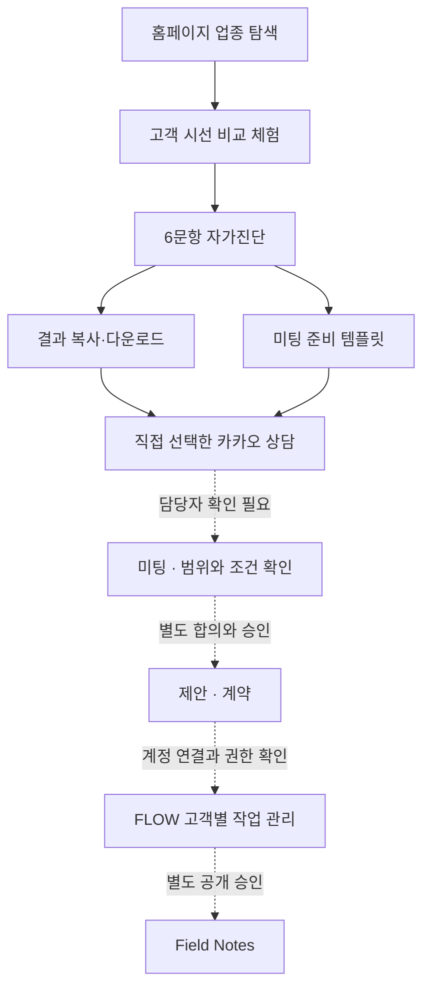

# 고객 여정 → FLOW 운영 연결 기준

기준일: 2026-10-19 KST. 실행 기준: `WEPLACE_Work_Rebuild_Brief_v1.1_FLOW_Integrated_2026-10-19(1).md`, `OWNER_EXPERIENCE.md`.

이 문서는 고객이 경험하는 단계와 실제 FLOW의 객체·상태를 구분한다. **여정의 단계 이름은 운영 DB에 쓸 상태 값이 아니다.** 현재 홈페이지에서 누른 버튼·체크·복사는 상담 접수, 미팅 확정, 계약이나 결제의 증빙이 되지 않는다.

## 이번 구현에서 이어진 흐름

실선은 공개 화면의 선택 경로, 점선은 담당자의 확인 또는 운영 승인이 필요한 업무 전환이다. 도식은 자동 인입 완료를 뜻하지 않는다.

## 단계별 현재 구현과 증빙

| 고객 여정 단계 | 고객이 하는 일 · 화면 | 실제 남는 기록 | 다음 단계의 증빙 | 승인 또는 미확인 항목 |
|---|---|---|---|---|
| 업종 탐색 | `/`의 `#working-industries`, 식당·카페·숙박·뷰티 선택 | 홈페이지 메모리 안의 선택 | 선택한 업종의 질문 화면 | 신규 행동 추적 활성화는 별도 승인 |
| 고객 시선 체험 | `/#experience`의 목적 선택·예시 비교 | 예시 선택 상태만 메모리에서 유지 | 실제 매장 진단과 구별한 예시 확인 | 예시가 실제 성과나 고객 사례로 오해되지 않게 표시 |
| 자가진단 | `/check/?industry=...`, 6문항 직접 답변 | 브라우저 메모리만 사용; 자동 저장·API·분석 전송 없음 | 6개 답변으로 만든 자체 보고 요약 | 계정 연결·자동 리드 저장 OFF |
| 결과 보관 | 사용자가 복사 또는 TXT 다운로드 선택 | 클립보드 또는 사용자가 내려받은 파일 | 보관 동작만 확인 가능 | 복사·다운로드는 상담 접수가 아님 |
| 상담 | 기존 카카오 채널로 이동, 사용자가 직접 전송 | 웹사이트는 접수 여부를 알 수 없음 | 담당자가 실제 받은 문의 확인 | 카카오 클릭만으로 리드·상담 성공을 만들지 않음 |
| 미팅 준비 | `/meeting/?industry=...`의 화면·질문·예시·범위·조건·다음 대화 확인 | 체크와 라디오 선택은 메모리; 복사·인쇄는 사용자의 명시적 동작 | 당사자가 일정과 논의 내용을 별도 확인 | 미팅 예약 API·자동 일정·계약 기능 미연결 |
| 제안 | 실제 화면과 진단 요약을 참고해 담당자가 범위·일정·수정·담당·가격·조건 작성 | 기존 `flow_briefs`에 연결 가능; 이번 화면에서 쓰지 않음 | 버전이 있는 제안서와 상대 확인 기록 | 템플릿의 항목은 납품 약속이 아님; 가격·VAT·환불 미확정 |
| 계약 · 결제 | 정식 조건 합의 및 승인된 계약·결제 절차 | 계약 확정 증빙과 결제 확인은 별개 | 계약 주체·범위·서명·결제 확인 | 실제 계약·PG 활성화 OFF; 가짜 성공 화면 없음 |
| 고객별 작업 관리 | `/my-store/` 설명 후 `/client`로 연결 | 기존 인증된 FLOW에서 권한에 맞게 관리 | 고객 계정·계약·프로젝트 연결 확인 | 홈페이지에서 직원 화면이나 인증 로직을 복제하지 않음 |
| 공개 기록 | 승인된 작업을 Field Notes로 공개 | 기존 공개 API 계약으로만 조회 | 공개 승인·비식별·사용권·기간 조건 | 계약 자료·내부 메모·고객 식별자를 공개 응답에 섞지 않음 |

## 전달 가능한 맥락과 경계

| 연결 | 이번 허용 값 | 전달하지 않는 값 |
|---|---|---|
| 홈 → 자가진단 | `industry=dining\|cafe\|stay\|beauty` | 목적 상세, 자유입력, 매장명, 연락처, 답변 |
| 자가진단 → 미팅 안내 | 위 네 업종 또는 `other` | 6문항 답변, 결과 제목·추천, 고객·계정 ID |
| 미팅 안내 → 자가진단 | 동일한 업종 whitelist | 체크 상태·다음 대화 선택·임의 쿼리 |
| 복사·다운로드 | 사용자가 화면에서 확인한 요약, 명시적 클릭 시만 | 자동 서버 업로드·CRM 등록 없음 |
| 카카오 상담 | 기존 채널 URL로 이동 | URL에 진단 요약·상호·전화·토큰 첨부 없음 |

`/check/`와 `/meeting/`에는 분석 스크립트를 추가하지 않았다. 자가진단 답변은 GA4, 콘솔, URL, localStorage, sessionStorage, 쿠키 또는 API로 쓰지 않는다. 신규 추적 이벤트는 이번 미리보기의 실행 범위에 포함하지 않는다.

외부 카카오 채널에서 사용자가 직접 전송한 내용은 해당 채널의 처리 범위다. 홈페이지는 보낸 사실·담당자 응답·예약 여부를 추측하지 않는다.

## 실제 CRM 객체·상태 매핑

**CONFIRMED (원본 코드):** `HotCharliepepper/WEPLACEFLOWVisualBaselineV0.2`의 `feature/industry-folders-20261014`, commit `29dace237c8a2ce2323a499409a81aa28a12a50b`에서 실제 서버·도메인 모델을 확인했다. 이전 `main`의 시각적 기준본과 구분한다. 원본 ZIP 226개 파일과 GitHub 동일 commit의 blob 226개가 일치하며 프런트엔드 재현 빌드도 운영 화면과 일치한다. Netlify drop 배포의 commit 메타데이터는 여전히 null이고, 운영 서버 바이너리의 바이트 단위 비교까지 완료한 것은 아니다.

| 사용자 관점의 단계 | 현재 확인된 운영 객체·상태 | 홈페이지 연결 판단 |
|---|---|---|
| 상담 접수 | `flow_prospects`; 기존 action은 `sheet`, `previewImport`, `import`, `save` | 익명 신규 접수 endpoint 없음. 홈페이지에서 기존 직원 API를 호출하지 않음 |
| 상담 응대 | Prospect `stage`: `신규`, `재통화`, `관심`, `가망`, `미팅예정`, `제안중`, `보류`, `완료(기존)`, `계약성사`, `종료`, `연락중단` | 담당자가 근거를 보고 기존 단계 선택. `완료(기존)`을 계약·결제 완료로 해석하지 않음 |
| 거래처 관계 | `operations.accounts[].stage`: `new`, `recontact`, `interested`, `considering`, `active`, `paused`, `closed` | Prospect 단계와 별도 체계. 자동 전환·일대일 매핑 없음 |
| 미팅 제안·확정 | `operations.events`, type `meeting`; status `planned`, `done`, `cancelled` | `planned`는 시스템의 일정 상태. 상대와 일정 합의·참석 확인은 별도 증빙이 필요 |
| 제안 작성·공유 | `flow_briefs`, `accountId`, `revision`, `content`; 근거 `confirmed/verify/hypothesis`, 상품 `approved`, VAT `included/excluded/undecided` | 승인된 상품·근거의 고객용 출력 사용 가능. `customerReviewed` 필드를 실제 상대의 계약 동의로 확대 해석하지 않음 |
| 계약 확정 | 거래처 `contractStatus`: `none`, `proposed`, `active`, `ended`; 계약 기간·금액 필드 | Prospect `계약성사`만으로 계약, 계정 grant, 결제를 생성하지 않음 |
| 결제 확인 | 거래처에 `paymentNote` 존재 | 메모 필드는 PG 검증 증빙이 아님. 검증된 전자계약/결제 전환은 미구현·미확인 |
| 고객 계정 연결 | 별도의 `flow_client_grants`; 연결 코드·담당 owner 확인·active grant | 팀 membership과 분리. 계약 후 자동 발급으로 가정하지 않음 |
| 작업 요청 | `flow_client_records`, kind `request`; `received`(접수), `planned`(일정 협의), `working`(진행 중), `done`(완료), `cancelled`(취소) | 인증된 본인 계정만 요청. 요청이 추가 유료 발주·청구를 뜻하지 않음 |
| 공유 작업 | 같은 객체의 kind `work`; `planned`(예정), `working`(진행 중), `done`(완료) | active grant와 명시적으로 공유된 작업만 고객에 노출 |
| 공개 저널 | `draft`, `submitted`, `published`, `archived`; 공식 workspace와 owner 승인 | `published` 공개 projection만 사용. 고객 동의·내용 검수는 별도 조건이며 내부 작업 자동 공개 없음 |
| 공개 업종 현황 | 승인된 profile·유효 기간·`contractStatus=active`; capacity는 별도 승인 | 승인 없는 정원·잔여 수를 생성하지 않음. 저널에 업종 현황과 동일한 자동 만료 필드가 있다고 가정하지 않음 |

원본 근거: `src/app/domain/{prospects,operations,brief,client-portal,publication}.ts`, `netlify/server/{prospect-database,client-database,brief-database,publication-database,publication-policy}.ts`. 현재 기술 실사 보고서의 전체 출처·검증 범위는 `flow-integration-inventory.md`를 우선한다.

**NEED VERIFY:** 실제 두 계정의 운영 로그인·고객 연결/해지, 현재 공식 팀과 승인 책임자, 운영 백업 복원 절차. 실제 고객 데이터를 사용한 테스트나 운영 쓰기는 수행하지 않았다. 소스 확인과 합성 데이터 테스트를 운영 계정 실증으로 바꾸어 보고하지 않는다.

## 미팅에서 운영 기록으로 넘길 최소 체크리스트

담당자가 실제 원본과 권한을 확인한 뒤 기존 FLOW 절차로 처리한다. 아래 항목을 새로운 DB 테이블이나 상태로 자동 생성하지 않는다.

1. **현재 화면** — 함께 확인한 채널·확인일·불일치. 고객 대화나 예약 명단을 공개 자료에 넣지 않는다.
2. **질문** — 실제 고객 질문과 이번에 확인하려는 가설을 나눠 기록한다.
3. **범위** — 대상 화면·수량·제외 사항·필수 자료·접근 권한.
4. **담당과 일정** — 책임자·납기·검수자·수정 기준·추가 작업 승인 방식.
5. **거래 조건** — 총액·VAT·착수·별도 비용·변경·해지·환불. 미확정을 체크 표시로 합의 처리하지 않는다.
6. **진행 결정** — 제안 요청, 보류, 계약 확정, 결제 확인을 각각 근거와 함께 구분한다.
7. **계정 연결** — 계약 후 고객 계정과 본인 작업만 연결되는지 확인한다.
8. **공개 여부** — 사례 공개 동의는 계약·업무 요청과 별도로 판단한다.

## 다음 실험과 승인 게이트

| 단계 | 허용하는 작업 | 다음 단계 전 필요한 승인·검증 |
|---|---|---|
| 현재 공개 홈페이지 PR | 예시 체험·메모리 진단·미팅 준비·기존 포털 안내 | 사용자 미리보기 검토 후 병합·운영 배포 승인 |
| 원본 실사 | 소스·배포·인증·공개 API의 읽기 전용 점검 | 운영 소스와 재현 가능한 빌드 확인; 담당자 및 테스트 계정 |
| 로컬/격리 테스트 | 가짜 데이터, 실제 DB·메일·알림 없이 검증 가능한 계약 설계 | 실사용 모델과 상태 매핑, 인증·중복·실패·권한 테스트 |
| 자동 문의 인입 | 현재 OFF | 별도 수집 동의·최소 필드·보존/삭제 정책·서버 검증·권한·최종 사용자 승인 |
| 계약·결제·작업 생성 | 현재 OFF | 가격·VAT·해지/환불·주체·PG/계약·계정 연결·운영 승인 |
| 실적·공개 사례 | 기존 승인 정책 유지 | 공개 가능 필드·고객 승인·사용권·기간·성과 근거 |

## 이 문서의 상태

- **CONFIRMED (소스 기준):** 6문항 자가진단은 클라이언트 메모리 처리. 카페를 별도 선택할 수 있고 업종 whitelist만 미팅 페이지로 전달한다. 미팅 준비 템플릿은 noindex이며 자동 저장·계약·결제를 구현하지 않는다.
- **CONFIRMED (FLOW 원본):** 실제 Prospect·거래처·일정·제안·고객 grant·요청/작업 상태와 공개 정책을 원본에서 확인했다. 실제 운영 기록은 변경하지 않았다.
- **NEED VERIFY:** 운영 계정 로그인·고객 연결/해지 실증, 현행 승인 책임자·공식 팀·백업 복원 절차. 별도 기술 실사 문서의 검증 범위를 따른다.
- **HYPOTHESIS:** 같은 화면에서 질문·범위·조건을 확인하면 미팅의 이해와 의사결정이 쉬워질 수 있다. 전환율·매출 개선 수치로 단정하지 않는다.
- **APPROVAL REQUIRED:** 운영 배포·병합, 새 추적 활성화, 자동 리드 저장, 실제 고객 데이터 쓰기, 권한 변경, 계약·결제 활성화.
