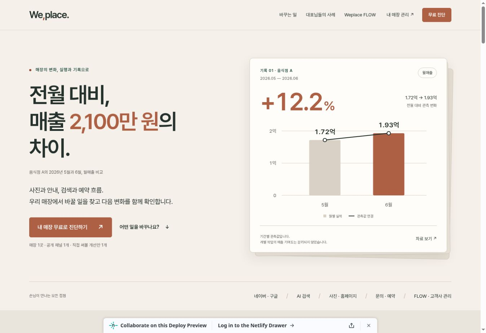
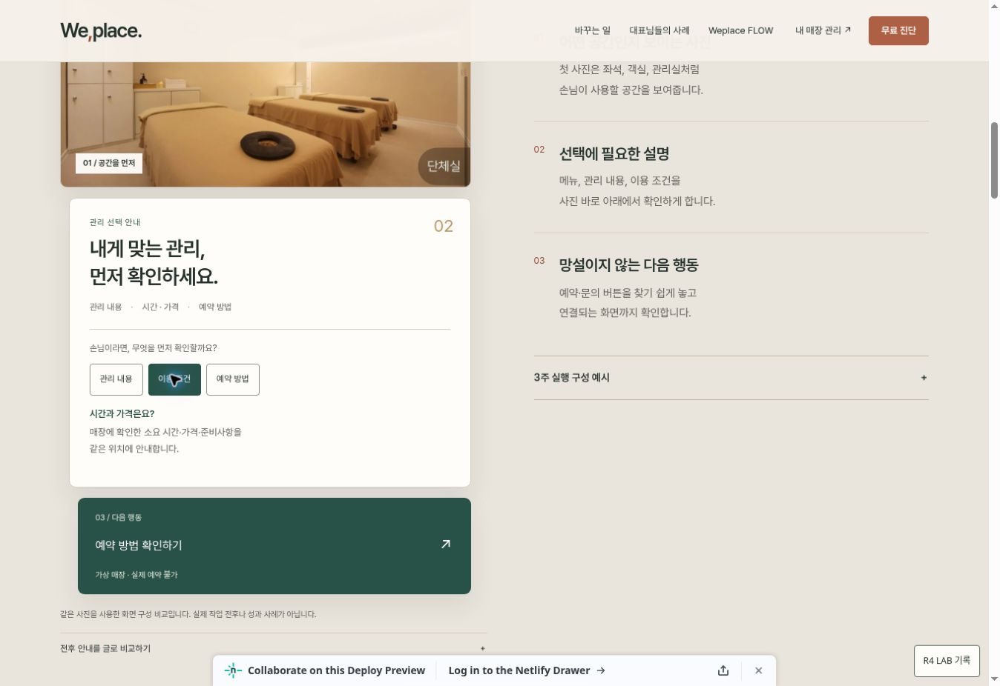
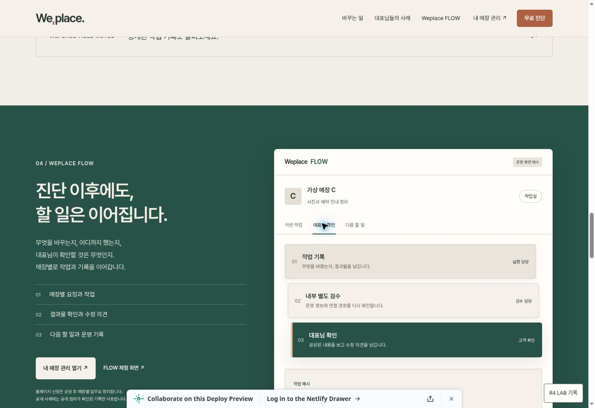
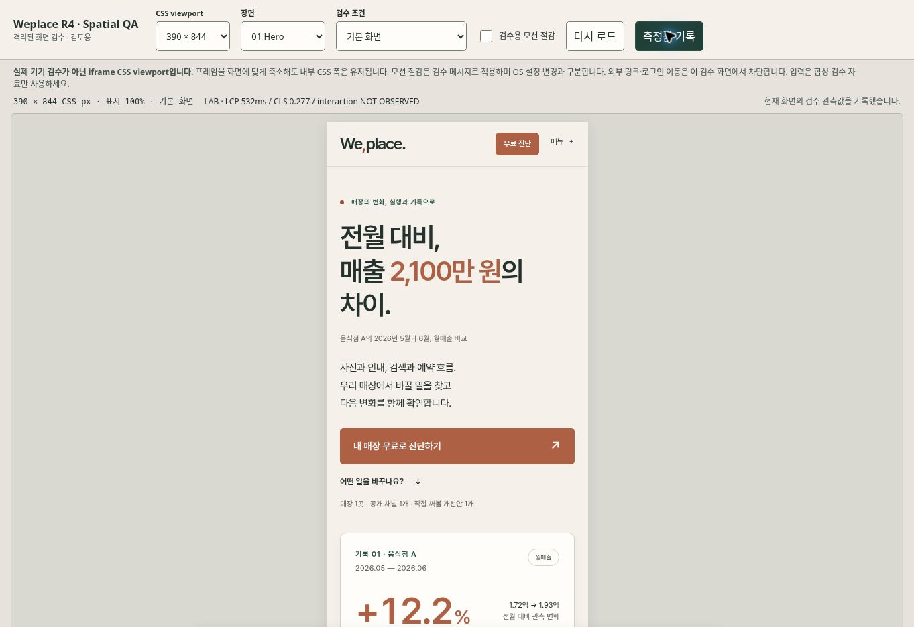

# Weplace R4 Spatial Experience — 검토 인계

작성일: 2026-11-03. R2 메시지·수치·FLOW를 보존하고 핵심 3장면에 깊이와 상호작용을 추가한 Draft 작업이다.

## 1. 디자인과 비교 기준

| 산출물 | 링크 |
| --- | --- |
| 편집 가능한 Figma 파일 | [Weplace R4](https://www.figma.com/design/paULgpd0M3t3s4q1SG361a) |
| 데스크톱 1440 / 모바일 390 | [Desktop 3:2](https://www.figma.com/design/paULgpd0M3t3s4q1SG361a?node-id=3-2) · [Mobile 4:2](https://www.figma.com/design/paULgpd0M3t3s4q1SG361a?node-id=4-2) |
| 핵심 3장면의 A/B/C 상태 | [Storyboard 10:2](https://www.figma.com/design/paULgpd0M3t3s4q1SG361a?node-id=10-2) |
| 모바일·모션 절감 / QA 상태 | [Fallback 10:209](https://www.figma.com/design/paULgpd0M3t3s4q1SG361a?node-id=10-209) · [QA 11:21](https://www.figma.com/design/paULgpd0M3t3s4q1SG361a?node-id=11-21) |
| 기존 FigJam 설계 | [R4 스토리보드와 제작 흐름](https://www.figma.com/board/QnhjcEPZctjddj7L4wWwGm) |

Figma 6개 페이지의 텍스트·벡터·컴포넌트는 편집 가능하다. [디자인 인계](design/FIGMA_HANDOFF.md), [노드·토큰 매핑](design/figma-handoff.json), [PNG 검증 목록](design/screenshots-manifest.json)을 제공한다. `design/*.png`는 Figma 출력이며 브라우저 증거와 구분한다.

R2 Draft #13 기준은 `06647cb859fa97c3f96f1c3995388262776d8dc6`, R3 Draft #15 작업 부모는 `40ae3c903111334ebc1a4b78da9faceaa298c6c8`이다. main·OS #14·기존 배포 확인값은 [소스 감사](source-audit.md)에 있다. R4 최종 커밋과 구분한다.

**폰트 한계:** Figma에 Pretendard가 없어 Noto Sans KR로 대체했다. 웹은 Pretendard를 유지한다. AS-IS는 네이티브 구조 재구성이다. 자동 캡처나 픽셀·폰트 동일성을 주장하지 않는다.

## 2. Preview·PR 제출 상태

| 제출 항목 | 현재 상태 |
| --- | --- |
| R4 Draft PR | [Draft PR #16](https://github.com/HotCharliepepper/Weplace/pull/16) |
| Netlify Preview | [Netlify Deploy Preview](https://deploy-preview-16--weplace.netlify.app/) — ready, deploy-preview |
| 작업 브랜치 | `draft/weplace-r4-spatial-20261103` |
| 구현 검증 커밋 | `58de2afaadd066a80d749a6c21f6b6ae2a884979` — 뒤따르는 문서·증빙 커밋과 구분 |
| 실제 화면·브라우저 결과 | [브라우저 QA 보고](BROWSER_QA.md) · [실화면·원시 JSON](browser/) |

[배포 검증](deploy-verification.json)에 ready 상태·정확한 구현 커밋·운영 배포 보존을 기록했다. base main에는 선행 미병합 R2/OS/R3 변경이 포함되므로 [R4-only diff](https://github.com/HotCharliepepper/Weplace/compare/40ae3c903111334ebc1a4b78da9faceaa298c6c8...58de2afaadd066a80d749a6c21f6b6ae2a884979)로 새 구현을 검토한다.

Preview에는 공개 가능한 정적 자료만 포함한다. 기존 [빌드 스크립트](../../scripts/build-site.mjs)는 HTML·`X-Robots-Tag`에 `noindex, nofollow`를 적용하고 canonical `https://withweplace.kr/`를 보존한다. `noindex`는 접근 통제가 아니다. 내부 감사·테스트·설정은 배포에서 제외한다.

## 3. 구현 범위와 모션 소유권

| 장면 | 구현과 Figma 매핑 | 기능 보존 |
| --- | --- | --- |
| Hero | `#intro .hero-proof`, Desktop `3:7` / Mobile `4:7`. 배경 2개 층과 전면 근거 카드, 짧은 진입 및 차트 연결선 표시 | H1·숫자·축·막대·주석은 처음부터 표시. 모바일 Hero는 정적 |
| 가상 매장 C | `#change-panel`, `3:40` / `4:40`. 사진→조건 설명→예약 방법의 3개 DOM 층, Before/After와 질문 선택 | 동일 사진을 쓴 구성 비교. 실제 예약·가격 확정·전환 성과를 의미하지 않음 |
| 공개 FLOW | `.flow-board`, `3:67` / `4:67`. 작업 기록·내부 검수·대표 확인의 역할 층과 기존 작업 패널 | `work→작업`, `review→대표 확인`, `next→검수` 강조. 저장·승인·완료 상태를 변경하지 않음 |

[`main-landing-r2.js`](../../assets/js/main-landing-r2.js)는 기존 탭·키보드·근거 대화상자·수동 문의 기능을 담당한다. [`spatial-demo.js`](../../assets/js/spatial-demo.js)는 Store C 질문을, [`main-landing-r4.js`](../../assets/js/main-landing-r4.js)는 선택적 GSAP 모션을 담당한다. [`main-landing-r4.css`](../../assets/css/main-landing-r4.css)는 기존 레이아웃 위에 토큰·깊이·반응형 규칙을 적용한다.

`data-motion-owner="gsap"` 요소는 기존 WAAPI 진입·IntersectionObserver reveal·탭 모션에서 제외한다. GSAP `context`·`matchMedia`가 타임라인을 재사용하고 이벤트·트리거를 정리한다. 연속 선택·폭 변경·문서 비활성화·bfcache 복원에서도 선택과 포커스를 유지한다. 강제 스크롤·WebGL·인증 FLOW는 추가하지 않았다.

JavaScript 없이 핵심 설명·Store C 답변·FLOW 역할을 HTML로 읽을 수 있다. GSAP 누락 시 기능은 유지한다. OS 모션 절감은 R4 타임라인을 생성하지 않는다. 검수 스위치는 OS 설정과 구분한다.

## 4. 수치·콘텐츠 보존 계약

| 근거 | 유지한 값과 해석 |
| --- | --- |
| 음식점 A | 2026년 5월 172,000,000원 → 6월 193,000,000원. 차이 21,000,000원, 반올림 +12.2% |
| 웰니스 B | 5–8월 플레이스 유입 877 / 1,137 / 2,002 / 2,350. 5월 대비 8월 반올림 +168% |
| 차트 | 원본 SVG 좌표·눈금·단위·0 기준선·선형 비례를 보존. Figma 이미지를 차트 자산으로 대체하지 않음 |
| 성과 해석 | 기간 관측값이며 개별 작업의 기여도를 분리하지 않음. 유입은 방문객·예약·매출과 다른 지표 |
| 무료 진단 | 매장 1곳·공개 채널 1개·개선안 1개. 요청문 생성·복사는 접수가 아니며 사용자가 카카오에서 직접 전송 |

BI·Ribbon·사진·법적 설정·리다이렉트 등 24개 파일의 바이트 [보호 기준](protected-baseline.json)과 공개·직원·고객 경로, 실DB·인증·권한 경계를 유지한다.

## 5. 검수 증거와 재현

| 검수 | 확인된 결과 |
| --- | --- |
| 전체 자동 테스트 | **83/83 통과**, 실패·건너뜀 0 — [최종 전체 로그](final-verify.txt) |
| R4 집중 회귀 | **9/9 통과** — [로그](r4-regression-final.txt). 전체 83개에 포함되는 부분집합 |
| 내부 링크 | HTML 35개, 참조 1,063개, 로컬 결함 0. 외부 URL 19개는 탐색하지 않음 — [로그](link-check.txt) |
| Figma 검수 | 가로 넘침·사진 누락·모바일 줄바꿈 보정, PNG 7개 디코딩 확인 — [인계](design/FIGMA_HANDOFF.md) |
| 실제 브라우저 | 5개 CSS 폭 가로 넘침 없음, 탭·모바일 메뉴·근거 모달·정적/누락 fixture 확인 — [상세 보고](BROWSER_QA.md) |
| 성능·보조기술 한계 | Netlify top-level LAB LCP 524ms, CLS 0.001. Event Timing에 긴 paint 지연이 남아 INP는 판정 보류. 필드 p75·물리 기기·네이티브 스크린리더는 NOT RUN |

자동 검증 범위는 GSAP 누락·no-JS·OS reduced-motion media query 모의 환경·실제 GSAP·100회 전환·중복 모션·미디어 변경·bfcache다. 저장소 루트에서 재현한다.

```sh
npm test
npm run check:links
npm run build
```

`/review/spatial.html`은 1440/1280/768/390/320 CSS 폭과 JS 차단·GSAP 누락·사진 누락을 지원한다. iframe과 실제 기기 검수는 구분한다. 키보드·스킵 링크·대화상자 복귀·폼 오류·클립보드·스크린리더 결과는 별도 기록한다.

목표는 LCP ≤2.5초, INP ≤200ms, CLS ≤0.1이다. 환경·폭·네트워크·CPU와 원시 상호작용 로그는 [브라우저 QA](BROWSER_QA.md)에 있다. iframe 초기 이동과 배치 자동화의 paint 지연도 원시 기록에 보존했다. 로컬 실험실 값으로 필드 75백분위 통과를 선언하지 않는다. 미관측 interaction은 미측정이다.

## 6. INSIGHT의 독립 구현 계획

| 단계 | 다음 작업 | 담당과 종료 조건 |
| --- | --- | --- |
| 1. 콘텐츠 검증 | 승인된 FIELD NOTE와 연결할 주제·출처·사진·공개 범위 정리 | 콘텐츠 담당·사례 소유자: 근거와 사용 허락 확인 |
| 2. 정적 읽기 화면 | 별도 PR에서 `/insight/` 목록과 글, 읽기 중심 HTML·메타·canonical·내부 링크 구현 | 프런트엔드·SEO 검수: 승인된 글로 Preview 확인 후 공개 결정 |
| 3. 편집 흐름 설계 | 초안→내부 검수→공개 승인, 수정 이력과 회수 방법 명세 | 운영 담당·개인정보 검토자: 역할·보관·접근 범위 승인 |
| 4. CMS·인증 검증 | 별도 승인 후 격리된 환경에서 저장·권한·감사·복구 검증 | 시스템 담당: 보안·권한 테스트 및 별도 배포 승인 |

이번 R4는 Insight Card와 계획까지다. CMS·관리자 글쓰기·인증·저장은 구현하지 않는다. 담당 직무는 제안이며 승인 완료를 뜻하지 않는다.

## 7. 운영 배포 전 남은 조건

회사·개인정보 검사 **22개가 미해결**이다. 운영 빌드는 승인된 개인정보 HTML과 초안 마커 제거를 요구한다. 근거·승인일 조작과 gate 우회를 금한다.

`example-space.webp` 공개 사용 허락은 **NEED VERIFY**다. 저장소 재사용은 허락의 증거가 아니다. 사례 이름·수치·사진의 공개 범위도 확인한다. 검수 후에도 **main 병합, 운영 배포, 실DB·인증 변경은 각각 별도 승인**이 필요하다.

[ZIP 실행 방법](RUN_PREVIEW.md): 미리 빌드한 dist와 함께 제공하며, Python 3로 localhost에서 바로 검토할 수 있다.

## 8. 실제 화면

다음 이미지는 Figma 시안이 아닌 Netlify Preview의 실제 브라우저 캡처다. 모바일은 390 CSS px iframe 검수 환경을 함께 보여준다.








