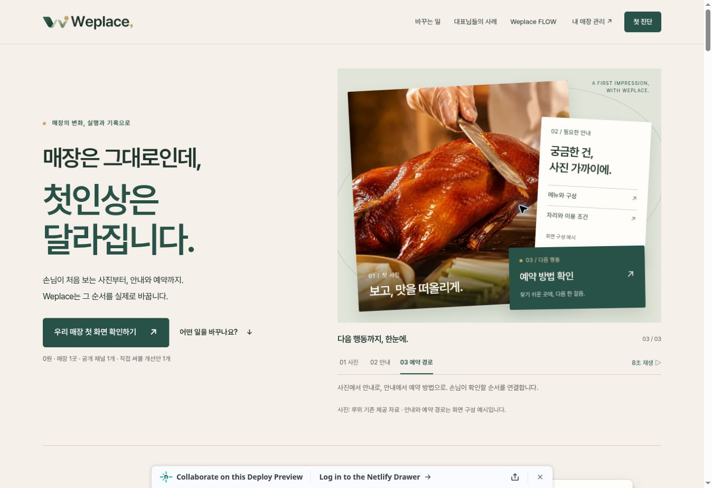

# R4.4 검토 배포 — 실제 방문 확인

- [Draft PR #20](https://github.com/HotCharliepepper/Weplace/pull/20)
- [Netlify Preview](https://deploy-preview-20--weplace.netlify.app/)
- 동작 검수 코드 HEAD: `bad97e07e59ea5a6847763389ee883758b9dc8b8`
- 확인한 배포: `6af004a2204bad7dae689808`, `ready`, `deploy-preview`
- 이 기록과 배포 화면 캡처를 추가하는 후속 커밋은 문서만 변경한다. 앱 소스·dist에 들어가는 자산의 변경은 없다.

## 인터넷 배포에서 직접 확인한 행동

1. 새 H1·서브카피·CTA, 기존 루위 사진 정상 로드. 3번 장면 선택 후 정적인 완료 화면 확인.
2. `어떤 일을 바꾸나요?` → 외관 먼저 → 메뉴 먼저: 실제 사진과 안내 전환.
3. FLOW `대표님 확인` 선택: 검수와 고객 확인을 구분한 기존 예시 내용 유지.
4. 메인 CTA → 진단 안내. `https://example.com/r44-review`라는 가상 URL로 요청문만 준비. 0원·1곳·1채널·1개 및 “아직 전송되지 않았습니다” 표시 확인. 카카오 채널로 발송하지 않음.
5. `진행 과정 체험하기` → 홈페이지 선택 → 무료 범위 → 모의 주문 확인 → 체험 완료 → 질문 카드. 실제 접수·결제가 아님을 각 단계에서 확인.
6. 질문 링크 복사 성공. `카드 저장`으로 실제 파일 다운로드 완료. **57,822바이트**, SHA-256 `37e4afcbda06d752e399130df1a06f4c09bbe8810d3ff59079193a0cfe3966b6`로 저장소 원본과 동일.
7. 별도 `/review/question` 페이지 → 브라우저 뒤로 → 모의 체험의 공유 단계 복귀 → 홈페이지 복귀.
8. 검토 홈을 완료 장면으로 남기고 실제 배포 화면 저장. [캡처](browser/live-netlify-hero.jpg), [검증 JSON](browser/live-verification.json).

기기 공유의 실제 수신자 선택·전송은 하지 않았다. 공유 성공/취소/미지원 분기는 Playwright 모의 API로만 확인했다. 데스크톱 클라우드 브라우저의 배포 검수와 7개 폭의 로컬 Playwright 검수를 구분한다.

## 운영 상태 재확인

2026-11-08 배포 후 조회 결과:

- GitHub main: `42562ec1a3dedec0e97b4fef1944aef4d84a6a49` — 착수 시와 동일.
- Netlify 현재 운영 배포: `6ad8a7438ddf68ea7482fcd2` — 착수 시와 동일.
- PR #20: Draft, open, merged=false. 기존 PR #18·#19 유지.
- 실DB·인증·실결제·외부 고객 메시지 변경/실행 없음.

