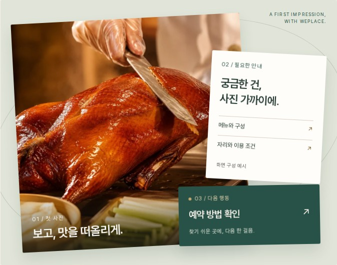
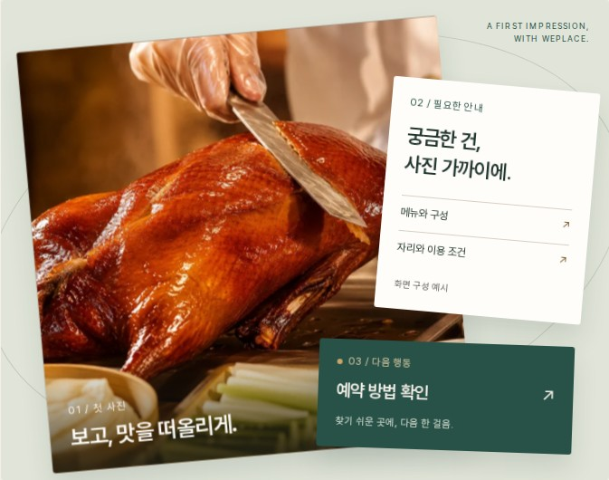
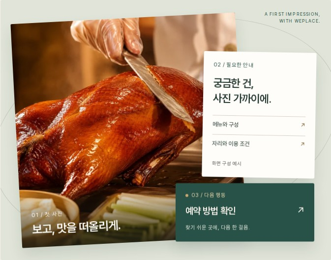

# WEPLACE R4.4 — 8초 히어로 콘티

현재 검토본은 **기존 실사 사진 + HTML/CSS/GSAP 모션**입니다. 새로운 실사 영상이나 AI 생성 영상을 확보·적용한 상태가 아닙니다. 사진의 실제 표면을 먼저 보여주고, 안내와 다음 행동이 정돈되는 순서입니다. 제목과 진단 CTA는 0초부터 별도로 보입니다.

| 시간 | 장면·시선 | 현재 구현 | 영상 도입 시 필요한 소스 |
|---|---|---|---|
| 0–2.8초 | 붉은 베이징덕 표면과 카빙 장면 | 검증된 기존 사진, 작은 위치 이동·기울임. 사진 속 인물·음식은 변형하지 않음 | 동일 매장의 승인된 카빙 실사 약 3초. 없으면 현재 사진 유지 |
| 2.8–5.6초 | 사진 옆에 메뉴·이용 조건을 정리 | 0.9초 GSAP 전환. 실제 텍스트는 HTML 카드 | 추가 촬영 불필요. 메뉴·이용 조건 확정 문구 |
| 5.6–8초 | 예약 방법을 찾는 다음 행동 확인 | 0.9초 정렬 후 8초에서 종료. 마지막 화면 자체가 완결 | 예약 방법·연결 위치 확인. 예약 완료/결제 성공 화면은 사용하지 않음 |

[편집 가능한 Figma 콘티](https://www.figma.com/design/paULgpd0M3t3s4q1SG361a?node-id=119-89)

## 재생과 실패 조건

- 데스크톱: 8초 1회 자동 재생. `장면 멈춤` / `8초 재생` 및 3개 수동 장면 탭. 종료 후 전체 장면에 최대 좌우 2°, 상하 1.5° 포인터 반응.
- 카드별 원근 회전은 사용하지 않음. 초기 검수에서 원근 깊이 때문에 사진이 안내 글자를 가리는 문제가 있어 평면 위치·기울임과 전체 장면 원근으로 정리함.
- 1000px 이하: 자동 재생 없음. 639px 이하는 사진과 예약 경로만 보이는 별도 정적 포스터. 장면 탭은 설명을 전환.
- 모션 감소: 자동 재생·포인터 움직임 없음. no-JS: 완성된 정적 사진, 설명, CTA 유지. GSAP 실패: 수동 설명과 CTA 유지.
- 사진 실패: 그린 바탕의 안내 폴백과 실제 진단 CTA 유지. 사진 로딩 대기 중에도 제목·CTA를 감추지 않음.
- 영상 도입 후 별도 검수할 계약: `muted`, `playsinline`, 1회, 무한 반복 없음, 정지/재생 버튼, 자동 재생 거절·오류·지연 시 포스터. 모바일·모션 감소에서는 영상 요청을 시작하지 않음. 현재 영상 요소가 없어 이 동작의 영상 QA는 미실시.

## 필요한 소스와 권한 상태

| 소스 | 상태 | 적용 위치·조건 |
|---|---|---|
| `assets/home-r42/luwei-peking-duck-640.webp` | 기존 제공 자료. 파일 바이트 그대로 재사용 | 모바일·일반 DPR 히어로, 기존 사진 비교 |
| `assets/home-r42/luwei-peking-duck-1254.webp` | 기존 제공 자료. 파일 바이트 그대로 재사용 | 큰 DPR 화면의 srcset 후보 |
| 기존 `R42_ASSET_PROVENANCE.md` | 제공 경로 기록 있음. 촬영자·권리자 확인서 아님 | 출처 검토 근거 |
| 촬영자/권리자의 상업 이용·편집·AI 변환 범위 확인 | 미확보 | 새 영상/AI 변환 작업 전 필요 |
| 승인된 실사 카빙 원본 | 미확보 | 0–2.8초에만 선택 적용. 공개 고객 얼굴·타 플랫폼 UI 배제 |
| 메뉴·이용 조건·예약 방법 확정 자료 | 미확보 | 현재는 명시된 화면 구성 예시. 실제 매장 UI로 공개하기 전 확인 |

원본 WebP SHA-256은 [preservation.json](preservation.json)에 기록했습니다. 사용자가 기존 사진의 우선 활용을 지시한 범위에서 검토본에 재사용했으며, 이 지시를 촬영자의 상업 이용·AI 변형 허락으로 간주하지 않았습니다.

## 선택적 Runway 작업 명세 — 실행하지 않음

새 영상은 필수 아닙니다. 권리 확인 후에도 실제 촬영본을 우선합니다. Runway 사용을 결정하면 **0–2.8초의 실사 질감 장면에만** 아래 참조를 검토하고, 안내·예약 카드는 코드로 유지합니다. 생성물을 실제 촬영본처럼 설명하지 않습니다.

- 참조: 기존 1254px 베이징덕 사진. 허용 범위가 확인된 원본만 입력.
- 생성 길이: 약 5초 소스 → 안정적인 2.8초 구간만 편집. 전체 구성은 8초.
- 적용 위치: 데스크톱 `.hero-photo`의 시각 레이어. 제목·CTA·정보 카드는 영상 밖.
- 영문 프롬프트 초안:

> Preserve the exact dish, hands, knife, table setting and warm red-gold lighting in the approved reference. A restrained slow camera push toward the Peking duck surface, with minimal natural carving motion. Keep food geometry and serving details stable. No new objects, no text, no logos, no dramatic steam, no invented interior, no camera roll. End on a still composition suitable for an interface overlay.

- 검토 기준: 칼·손·음식의 형태 변형, 허위 공간·재료 생성, 과도한 광택, 고유 상표·문자 생성 시 불채택.
- 선택적 납품 목표: 1920×1080, 24fps, 정확히 8초 편집본, H.264 MP4, 오디오 트랙 없음, 목표 3MB 이하. 포스터 파일과 권한 근거 함께 전달. 현재 이 파일은 생성하지 않았습니다.
