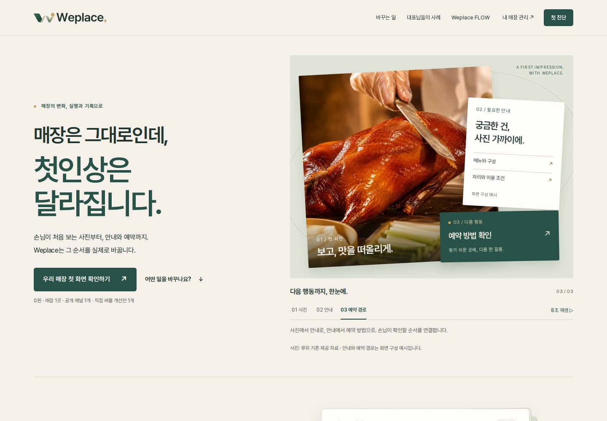
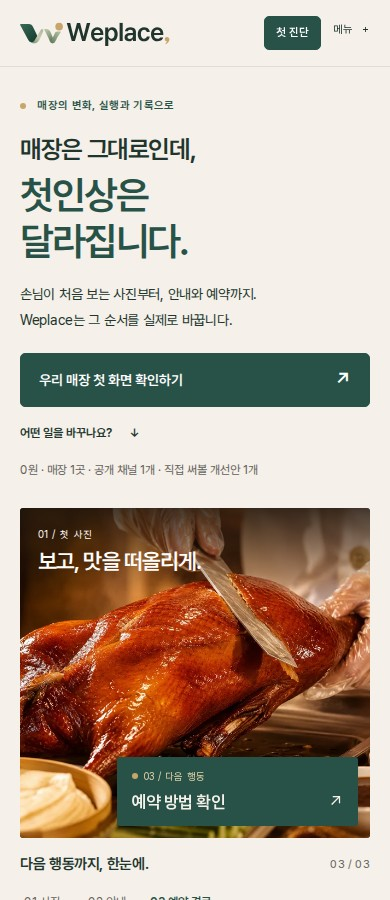

# WEPLACE R4.4 — Emotional Hero × Cinematic Execution

2026-11-08 검토본. 기존 페이지의 구조를 유지하고 히어로의 메시지·실사 사진·모션을 수정했습니다. 운영 main 병합, 운영 배포, 실결제, 실DB·인증 변경, 고객 메시지 발송은 하지 않았습니다.

## 1. 기준 원본과 보존

| 확인한 원본 | HEAD | 판단 |
|---|---|---|
| 운영 main | `42562ec1a3dedec0e97b4fef1944aef4d84a6a49` | 보존 |
| Draft PR #18 | `9e3df4f4e5f78cd8f3e7b7a961af868ead95a06a` | 요청된 R4.3 기준 확인 |
| Draft PR #19 | `49b123e0124fb3d837650bc8511bb9503f819d59` | 앞선 Work의 추가 검수·타이포·공유 개선이 있어 이 HEAD에서 분기 |

새 브랜치: `draft/weplace-r44-emotional-hero-20261108`. PR #18·#19와 기존 Figma 페이지는 수정하지 않았습니다.

- 접힌 W와 금색 점, 크림·포리스트 그린·세이지·골드 체계 보존.
- 음식점 A의 2026년 5월/6월 **1.72억 → 1.93억, +12.2%, 2,100만 원** 및 기존 관측값·귀속 한계 문구 보존. 루위 사진과 음식점 A의 수치를 동일 사례라고 새로 연결하지 않음.
- 루위 **메뉴 먼저 / 외관 먼저** 비교와 실제 음식 사진 유지.
- **0원 · 매장 1곳 · 공개 채널 1개 · 직접 써볼 개선안 1개** 보존. 미확정 가격·한정성 추가 없음.
- 첫 근거 섹션부터 마지막 질문 카드까지 HTML이 기준본과 바이트 단위로 동일함: [preservation.json](preservation.json).
- FLOW·CRM·인증·DB·결제·기존 고객 경로와 관련 파일 수정 없음.

## 2. 발견한 문제와 실제 수정

| 위치·근거 | 수정 |
|---|---|
| 기존 히어로는 도식 카드 중심. 실제 매장의 질감이 두 번째 장면에서야 나타남 | 기존 루위 실사 사진을 첫 화면으로 끌어오고 안내·예약 카드와 결합 |
| 실행사의 역할을 첫 문장만으로 파악하기 어려움 | 요청한 H1·서브카피·CTA 반영. 실제 바꾸는 순서가 사진→안내→예약으로 읽히게 구성 |
| 기존 R4.3 모바일 자동 모션 | 1000px 이하 정적, 639px 이하 별도 사진 포스터 구도 |
| 구현 중 시작 장면의 원근 회전으로 안내 글자 일부 가림 | 카드별 Y축 회전 제거. 위치·기울기·그림자와 전체 장면 포인터 원근으로 깊이 표현. 세 장면의 글자 가림을 Playwright로 검사 |
| 새 문구에 필요한 일부 한글이 기존 폰트 부분집합에 없음 | `떠·맛·못` 3자만 OFL Pretendard 보완 폰트로 제공. 2개 파일 합계 1,688바이트 |

실제 변경 파일:

- [index.html](../../../index.html): 새 카피, 실제 사진, 의미 있는 장면 설명과 정적 폴백. R4.3 히어로 JS 참조를 R4.4로 교체.
- [main-landing-r44.css](../../../assets/css/main-landing-r44.css): 데스크톱 3개 시각 레이어와 모바일 전용 포스터.
- [main-landing-r44.js](../../../assets/js/main-landing-r44.js): 8초 1회, 정지·재생·키보드 탭, 전체 장면 포인터 반응, 실패·오프스크린·모션 감소 정리. H1·CTA의 opacity/진입 시점을 제어하지 않음.
- 기존 R4.3 JS 파일은 비교용으로 보존하지만 홈페이지에서 실행하지 않음. 기존 R4의 비교·FLOW 모션 소유권은 그대로 유지.

## 3. Before / After — 실제 Chromium 화면

| 폭 | Before: PR #19 | After: R4.4 |
|---|---|---|
| 1440px | [첫 화면](browser/before-1440-hero.jpg) · [전체](browser/before-1440-full.jpg) | [첫 화면](browser/after-1440-hero.jpg) · [전체](browser/after-1440-full.jpg) |
| 390px | [첫 화면](browser/before-390-hero.jpg) · [전체](browser/before-390-full.jpg) | [첫 화면](browser/after-390-hero.jpg) · [전체](browser/after-390-full.jpg) |
| 320px | [첫 화면](browser/before-320-hero.jpg) · [전체](browser/before-320-full.jpg) | [첫 화면](browser/after-320-hero.jpg) · [전체](browser/after-320-full.jpg) |

## 4. Figma — 편집 가능한 A/B와 콘티

[비교 보드 전체](https://www.figma.com/design/paULgpd0M3t3s4q1SG361a?node-id=117-3)

| 편집 프레임 | 링크 |
|---|---|
| A · R4.3 Desktop 1440 | [117:9](https://www.figma.com/design/paULgpd0M3t3s4q1SG361a?node-id=117-9) |
| B · R4.4 Desktop 1440 | [117:70](https://www.figma.com/design/paULgpd0M3t3s4q1SG361a?node-id=117-70) |
| A · R4.3 Mobile 390 | [117:145](https://www.figma.com/design/paULgpd0M3t3s4q1SG361a?node-id=117-145) |
| B · R4.4 Mobile 390 | [117:206](https://www.figma.com/design/paULgpd0M3t3s4q1SG361a?node-id=117-206) |
| 8초 3장면 콘티 | [119:89](https://www.figma.com/design/paULgpd0M3t3s4q1SG361a?node-id=119-89) |

301개 하위 레이어, 텍스트 145개, 인스턴스 11개, 장면 컴포넌트 3개. 전체 UI를 이미지로 평탄화하지 않았습니다. 이미지 채움은 실제 음식 사진에만 사용했습니다. 원본 브랜드 로고·CTA 컴포넌트와 기존 색상 변수를 재사용했습니다.

**서체 일치 검수는 미통과:** 연결된 Figma 환경에 Pretendard가 없어 기존 시안과 같은 Noto Sans KR로 편집 프레임을 만들었습니다. 웹은 Pretendard이며, 최종 줄바꿈·타이포 미감은 실제 화면 캡처가 기준입니다. 이 제한을 캔버스에도 명시했습니다. [구조·이미지·서체 기록](figma-manifest.json)

## 5. 8초 콘티와 영상 상태

[시간별 장면·실제 캡처·소스·권한·선택적 Runway 프롬프트](R44_STORYBOARD.md)

새 영상은 적용하지 않았습니다. 기존 사진 파일은 그대로 재사용했고, CSS/GSAP로 완성했습니다. 촬영자의 상업 이용·AI 변환 허용 범위를 입증하는 문서는 확인하지 못했습니다. 승인된 영상이 확보되기 전에는 현 검토본의 사진·코드 모션을 유지합니다.

## 6. QA

최종 결과와 재현 명령, 접근성·성능 측정 한계는 [R44_QA.md](R44_QA.md)에 기록합니다. JSON 근거는 [browser/](browser/)에 있습니다.

## 7. 검토 배포

Draft PR과 Netlify 검토 배포의 최종 HEAD·URL·실제 방문 기록은 [LIVE_REVIEW.md](LIVE_REVIEW.md)에 기록합니다. 운영 main 및 운영 배포 상태는 별도로 재확인합니다.

## 8. 운영 전 남은 확인

- 루위 사진 권리자·상업 이용 범위와 향후 영상/AI 변환 권한.
- 기존 사업자·개인정보 공개 승인 게이트. 검토 빌드는 기존처럼 noindex이며 운영 승인으로 간주하지 않음.
- 실영상 도입을 결정한 경우에만 무음·1회·재생 거부/오류·모바일 다운로드 방지와 예산 검수.
- Safari/iOS·Android 실기기, 스크린리더 사용자 검수, 실제 네트워크 성능과 필드 INP는 별도 확인.
- 사용자 인터뷰·신청 전환율을 측정하지 않았으므로 호감·신청·매출 상승을 확정하지 않음.

현재 판단: 처음에는 사진과 문장으로 매장 변화에 관심을 갖고, 중간에는 관측 수치와 비교로 작업을 이해하며, 마지막에는 첫 화면 진단 또는 질문 카드 저장·공유 중 다음 행동을 고를 수 있습니다. 이 경로의 작동은 확인하되 방문자의 실제 감정·전환 효과는 가설로 남깁니다.
