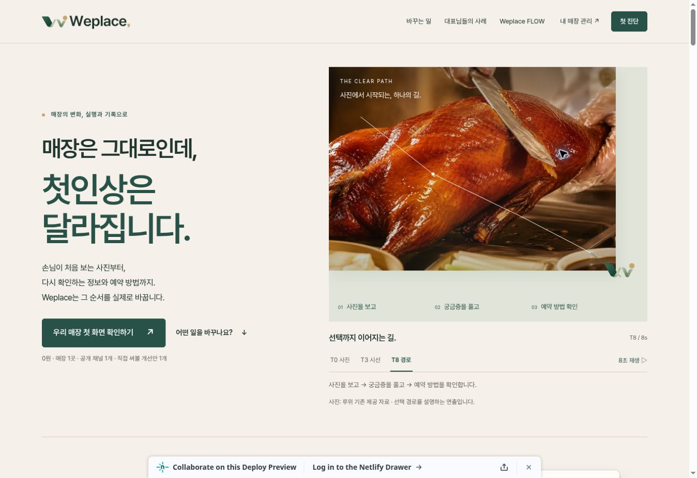

# R4.5 Live Preview

2026-11-08 실제 검토 배포와 브라우저 동작 확인. 운영 배포가 아닙니다.

- [Draft PR #21](https://github.com/HotCharliepepper/Weplace/pull/21), open / draft / not merged.
- [검토 Preview](https://deploy-preview-21--weplace.netlify.app/).
- 확인한 앱 코드: `e8950a68b3040fe1d23e22402ecb0168eba0f2d1`.
- 확인한 Netlify deploy: `6af038d11f08324d31a05af7`, `ready`, `deploy-preview`, 위 커밋과 일치.
- 기준 PR #20: `9ed15798e1ef90712ba842a7f873b230a1688cf0`.
- PR base는 Netlify 자동 Preview를 위해 main. 이전 미병합 Draft도 포함됩니다. [R4.5만의 변경 비교](https://github.com/HotCharliepepper/Weplace/compare/9ed15798e1ef90712ba842a7f873b230a1688cf0...draft/weplace-r45-clear-path-20261108)를 사용하세요.

## 실제 Preview에서 확인

Cloud Chrome, 실제 Netlify URL을 방문해 아래 행동을 수행했습니다. 로컬 Playwright의 8개 반응형 폭 검사와 구분합니다.

| 행동 | 관찰 결과 |
|---|---|
| 첫 화면·T3/T8 선택 | 제목·CTA·실사진 표시. T8 선택 후 완성된 선·Folded W·정지 상태, 재생 버튼 확인 |
| 숙박 기준 | 02 공간 이해 클릭, End 키로 05 도착 안심 선택. 설명 교체 및 예시 표시 유지 |
| 루위 비교 | 외관 먼저 → 메뉴 먼저에서 실제 이미지·정보·선택 상태 전환 |
| FLOW | 대표님 확인 탭에서 자료·운영정보 확인·수정 의견 설명 표시 |
| 메인 CTA | #request 이동. 무료 범위 유지 |
| 요청문 | 테스트 URL `https://example.com/r45-review`로 로컬 문구 생성. '아직 전송되지 않았습니다' 표시 확인. 채널 열기/발송은 하지 않음 |
| 모의 체험 | 5단계 직접 진행. 0원·1곳·1채널·1개 확인, 체험 체크 후 완료. '실제 진단 신청이나 주문이 접수된 것은 아닙니다' 표시 |
| 링크 복사 | '질문과 링크를 복사했습니다' 성공 안내. 외부 대화에 붙여넣거나 발송하지 않음 |
| 카드 저장 | 실제 JPG 다운로드 완료. 아래 SHA-256이 저장소 원본과 일치 |
| 독립 질문 페이지 | /review/question 진입, '실제 분석 결과가 아닙니다' 표시 및 Mashcore/Weplace 역할 문구 확인 |
| 뒤로 가기·홈 | 질문 페이지에서 모의 공유 단계 #step-4 복귀, 홈 복귀 후 히어로 확인 |

카드 다운로드 SHA-256: `37e4afcbda06d752e399130df1a06f4c09bbe8810d3ff59079193a0cfe3966b6`.

8초 정확한 재생 시간·폴백·모션 감소·전체 폭·접근성은 [로컬 자동 검수](QA.md)의 결과입니다. 라이브 브라우저에서는 실제 조작 경로와 화면을 확인했으며, 모든 로컬 시나리오를 다시 실행했다고 주장하지 않습니다. 조회된 브라우저 경고에는 Chrome 확장 프로그램의 metadata 전송 오류가 포함되어 앱 오류와 분리했습니다. 라이브 콘솔 전체가 무오류라고 판정하지 않았습니다.

## 원본·운영 보호 재확인

검수 후 GitHub/Netlify를 다시 읽어 다음 값이 시작 시점과 같음을 확인했습니다.

- main: `42562ec1a3dedec0e97b4fef1944aef4d84a6a49`.
- PR #20 HEAD: `9ed15798e1ef90712ba842a7f873b230a1688cf0`, draft / not merged.
- 현재 운영 deploy: `6ad8a7438ddf68ea7482fcd2`, ready.

검수 기록을 추가하는 후속 커밋은 docs/r4-spatial/r45/ 안의 문서·증빙만 변경합니다. FLOW·CRM·인증·DB 소스, 운영 설정, 실제 결제와 외부 고객 발송은 변경하거나 실행하지 않았습니다.
