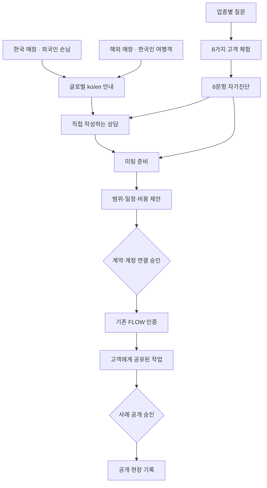

# WEPLACE v1.4 검토 안내

PR #8의 기존 브랜치에 국문·업종·인터랙션 패치와 글로벌 시범 경로를 구현했다. Draft와 Preview 상태를 유지하며 운영 배포는 하지 않았다.

- [PR #8](https://github.com/HotCharliepepper/Weplace/pull/8)
- [최신 Preview](https://deploy-preview-8--weplace.netlify.app/)
- [여섯 폭 검토 화면](https://deploy-preview-8--weplace.netlify.app/review/audience.html)
- [글로벌 국문](https://deploy-preview-8--weplace.netlify.app/global/) · [영문](https://deploy-preview-8--weplace.netlify.app/en/global/)
- [기존 FLOW 별도 Draft PR #10](https://github.com/HotCharliepepper/WEPLACEFLOWVisualBaselineV0.2/pull/10)

## 먼저 볼 장면

1. 홈의 네 업종 카드: 질문의 차이와 접지 않아도 보이는 체험 버튼.
2. 고객 체험: 4개 업종·8가지 상황·6문항 구성, 정리 전·후와 ‘나란히 보기’ 비교표.
3. 두 글로벌 방향: 한국 매장의 외국인 손님, 해외 매장의 한국인 여행객.
4. 각 서비스의 한국어/영어 전환과 수동 문의·미팅 안내.

## 변경 내용과 근거

| 제출 항목 | 문서 |
| --- | --- |
| 시작 PR·배포·이전 화면과 대조 | [현재 상태](v14-current-state.md) |
| 실제 적용한 국문 32개 수정 | [한국어 수정 대장](v14-korean-copy-audit.md) |
| 7개 파일 전수 읽기와 유지 근거 | [국문 전체 감사](v14-korean-copy-recommendations.md) |
| 업종 질문·이미지·근거·CTA 차이 | [업종 콘텐츠 매트릭스](v14-industry-content-matrix.md) · [업종 수정 대장](v14-industry-copy-audit.md) |
| 두 시장·ko/en·B2B/B2C 구매 의도 | [글로벌 GEO 키워드맵](v14-global-geo-keyword-map.md) |
| 글로벌 6페이지·metadata·범위 | [글로벌 페이지 검토](v14-global-page-review.md) |
| 숫자·도식·미래 성과 자료 기준 | [시각화 데이터 기준](v14-chart-data-contract.md) |
| 테스트·실제 브라우저·미검수 | [Preview 검수 결과](v14-browser-review.md) |
| PR #5·FLOW·승인 조건 보존 | [원본·권한 경계](v14-source-boundaries.md) · [결정·결함 기록](v14-decision-log.md) |
| 변경 파일 전체 | [변경 파일 목록](v14-changed-files.md) |

기존 v1.3 모션·Before/After·6문항·수동 메모·미팅·FLOW 경로를 유지했다. 국문은 뜻이 흐린 문장을 구체적인 행동으로 바꿨다. 업종 이미지 네 개는 최신 소스에서 이미 달라 원본을 보존했다. 긴 보조 설명은 native details로 접고, CTA와 필수 조건은 읽을 수 있는 위치에 뒀다.

숫자는 실제 기능 수만 표시한다. 8명 모임 등은 가상 상황이며 고객 실적이 아니다. 성과 차트를 만들 검증된 원자료는 없으므로 수치를 만들어 그래프로 채우지 않았다. 글로벌 검색어는 검증 단계의 후보이며 검색량·난도·순위·전환 수치를 주장하지 않는다.

## 홈페이지·글로벌·FLOW 연결

진단 답변·미팅 체크는 페이지 메모리에만 있다. 진단→미팅에 허용된 업종 토큰만 전달한다. 상담은 사용자가 외부 채널에 직접 작성한다. 제안·계약·계정 연결은 실제 운영 절차이며 웹사이트가 자동 실행하지 않는다. FLOW의 기존 인증·CRM·고객 접근 권한·공개 승인·API는 이번 패치로 변경하지 않았다. Mashcore는 기존 관점·연구 링크만 유지하며 계정·상담 기록 자동 공유는 없다.

## 확인된 결과

- 자동 62/62 통과, 30개 HTML·940개 참조의 로컬 링크 결함 0, review build 성공.
- Chrome의 360·390·430·768·1024·1440px 검토 iframe에서 대표 장면 렌더링 확인.
- 8개 상황·비교표·Enter/Space·모션 줄이기·6문항→미팅·정책 초안·기존 FLOW 로그인 연결 확인.
- 공개 기록 만료 시 초점 유실 결함 수정 및 회귀 검사.
- Before/After를 포함한 12장 원본 스크린샷과 비교 갤러리 별도 제출.

실제 휴대폰 터치·OS 모션 설정·화면 낭독기·200% 확대·실계정 권한·외부 원어민 검수는 완료로 표시하지 않는다. 상세 한계와 재현 경로는 검수 기록에 남겼다.

## 최종 승인 항목

- v1.4 문장·업종 질문·도식·글로벌 방향의 운영 공개 여부.
- 글로벌 대상 국가·언어·번역 검수·제작물·현지 응대·방문 지원·일정·비용 범위.
- 최신 법인 증빙과 개인정보 처리 항목·목적·보유/삭제·위탁·국외 이전·권리 창구. 기존 22개 확인 조건과 전문가 검토 필요.
- 실제 고객 사례의 제작·납품·실사용 사실 및 공개 동의, 수치 원자료·기간·단위·분모·해석·공개 승인.
- main 병합과 운영 배포, 검색 노출 허용. 글로벌 시범 페이지의 noindex는 명시적으로 검토 후 변경.
- FLOW 실제 고객 데이터·권한·개인정보 자동 저장·새 추적·실제 계약·결제는 별도 최종 승인 전 비활성 유지.

이번 Preview 검토 승인은 위 운영 변경의 실행으로 간주하지 않았다.
